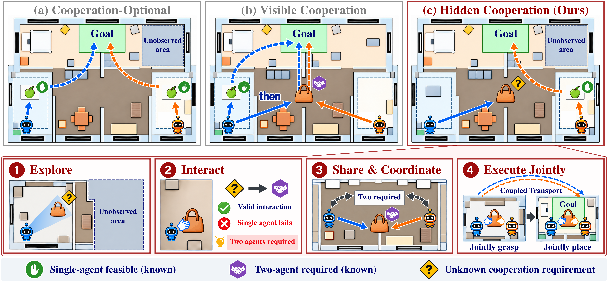
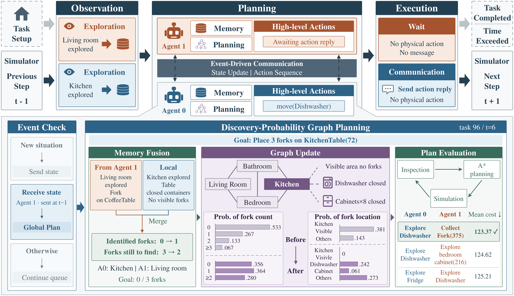

# DPGP

Implementation of **Discovery-Probability Graph Planning for Embodied Agents
in Tasks with Hidden Cooperation Requirements**.

This repository provides **HiddenCoop**, a benchmark built on C-WAH and
TDW-MAT, and **Discovery-Probability Graph Planning (DPGP)** for coordinating
exploration and transport under hidden cooperation requirements.

[Updates](#updates) · [Installation](#installation) · [Run experiments](#run-experiments) · [Contact](#contact)





## Updates

- **October 19, 2026:** Added installation and experiment instructions for C-WAH and TDW-MAT.

## Installation

Use Linux x86-64 with Conda. Create a separate environment for each benchmark.

```bash
git clone https://github.com/hnu-vis/DPGP.git
cd DPGP
```

### C-WAH

Run from the repository root:

```bash
conda create -n cwah python=3.9.12 -y
conda activate cwah
python -m pip install -r cwah/requirements.txt

git clone --branch wah https://github.com/xavierpuigf/virtualhome.git
```

Download the [C-WAH Linux simulator](https://drive.google.com/file/d/1JTrV5jdF-LQVwY3OsV3Jd3r6PRghyHBp/view)
and extract the complete archive into `DPGP/executable/`. Then run:

```bash
chmod +x executable/linux_exec.v2.3.0.x86_64
```

### TDW-MAT

Run from the repository root:

```bash
conda create -n tdw_mat python=3.9.13 -y
conda activate tdw_mat
python -m pip install -r tdw_mat/requirements.txt
```

On a remote GPU server, configure and start an X server following the
[TDW setup guide](https://github.com/threedworld-mit/tdw/blob/master/Documentation/lessons/setup/server.md).
Keep it running during experiments. Allow network access for the initial TDW build
and asset downloads.

### API configuration

Run one of the following configurations in the terminal used for experiments.

**OpenAI API**

```bash
export OPENAI_API_KEY="your-openai-api-key"
unset OPENAI_BASE_URL OPENAI_API_BASE
```

**OpenAI-compatible third-party API**

```bash
export OPENAI_API_KEY="your-provider-api-key"
export OPENAI_BASE_URL="https://your-provider.example/v1"
```

## Run experiments

### C-WAH

From the repository root, run all 100 tasks with three runs per task.
C-WAH trajectories are collected with a 600-second budget; the paper's main
results evaluate these trajectories at a 200-second cutoff.

```bash
conda activate cwah
cd cwah
mkdir -p ../test_results

python3 -B -u testing_agents/test_symbolic_experiment.py \
  --method-name dpgp \
  --dataset-path dataset/Test/aaa_test_env_set_help_100.pik \
  --executable-file ../executable/linux_exec.v2.3.0.x86_64 \
  --dpgp-prediction-mode discovery_probability \
  --llm-model gpt-4o-mini \
  --num-runs 3 \
  --max-embodied-execution-time 600 \
  --mode cwah_dpgp_probability \
  --existing-result-policy skip \
  --base-port 6217 \
  > ../test_results/cwah_dpgp_probability.txt 2>&1
```

Results: `DPGP/test_results/cwah_dpgp_probability/`.

### TDW-MAT

From the repository root, run all 48 tasks once. Set `DISPLAY` to your running
X server; the command below uses display 98.

```bash
conda activate tdw_mat
cd tdw_mat
export DISPLAY=:98
mkdir -p ../test_results

python3 -B -u tdw-gym/challenge_experiment.py \
  --method_name dpgp \
  --data_prefix dataset/dataset_test \
  --data_path test_env.json \
  --lm_id gpt-4o-mini \
  --eval_episodes -1 \
  --experiment_name tdw_dpgp_probability \
  --run_id run_0 \
  --experiment_seed 1024 \
  --port 10072 \
  --dpgp_prediction_mode discovery_probability \
  --max_embodied_execution_time 20 \
  --existing_result_policy skip \
  > ../test_results/tdw_dpgp_probability.txt 2>&1
```

Results: `DPGP/tdw_mat/results/tdw_dpgp_probability/run_0/`.

## Contact

For questions or collaboration, contact zihuangcai@hnu.edu.cn.

## License

See [LICENSE](LICENSE) for component licenses and attribution.